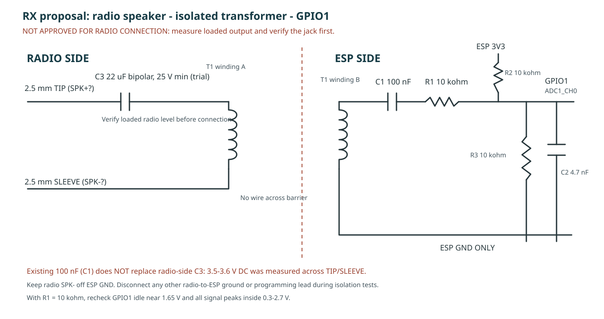
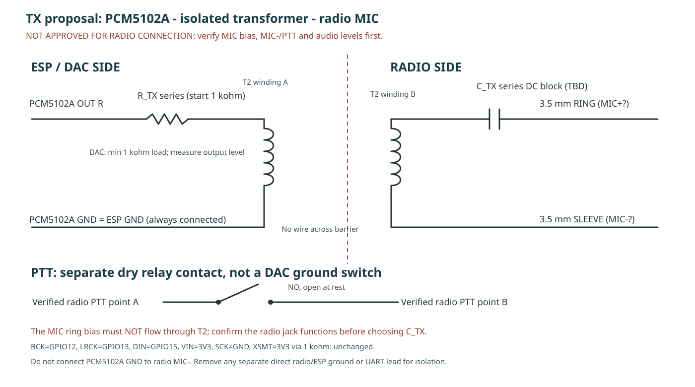

# Funkcionális hardverterv - rádióhang-felvevő

Ez a lista a [követelmények](../requirements.md) szerinti **felvétel, Wi-Fi webszerver, helyi/rádiós visszajátszás és automatizmusok** kipróbálásához szükséges hardvert gyűjti össze. Az akkumulátor, töltés, végleges ház és üzemidő most nincs méretezve. A felvétel jogi kérdése a projekt részéről tisztázott; ez a jegyzet nem vizsgálja újra. Az éterbe történő adást nem tekintjük az első próbapad részeként: a PTT és a rádió felé menő hang előbb külön, RF nélküli tesztterheléssel vizsgálandó.

## Rádióoldali mérés és GPIO1

**A rádiót az új leválasztott rajzok alapján sem szabad mérés nélkül csatlakoztatni.** A 2026-10-25-én a 2,5 mm-es tip és sleeve között mért érték vétel nélkül 0 V, vétel közben **3,5-3,6 V DC**, illetve **3,4-4 V AC** a multiméter szerint; az AC-érték a hangerővel változik. Ez nem megbízható terhelt RMS- vagy csúcsfeszültség. A DC közvetlenül a trafótekercsen folyna, ezért a vételi rajzon külön rádióoldali soros kondenzátor szerepel. A pontos jack-kiosztás, a terhelés alatti jelalak és a terhelés mérése még hiányzik. Hálózati földelésű szkóp földcsipeszét ne tedd ismeretlen rádióérintkezőre; differenciális vagy leválasztott mérési módszert használj. A rádiót a saját akkujáról járasd.

A megvett panel [pinout-képén](2026-10-24_11h20_03.png) **GPIO1 = ADC1_CH0**; a microSD-jelek GPIO38 = CMD, GPIO39 = CLK, GPIO40 = DATA0. A kamera kiosztását a konkrét panelen ellenőrizni kell. Az ADC próbában GPIO1 3,3 V és ESP GND között két 10 kΩ-os ellenállással kb. 1,65 V-ra előfeszített, a hang 100 nF-os soros kondenzátoron és **10 kΩ-os** ellenálláson jut be, a GPIO1 és ESP GND között 4,7 nF szűrőkondenzátor van. Ez ideálisan kb. 1/3-os ADC-oldali csillapítás; az új vételi rajz ezt az oldalt tartja meg. Rádió nélkül csak igazolt, biztonságos kis szintű próbaforrással mérj; a GPIO1 csúcsai maradjanak kb. 0,3-2,7 V között, semmiképpen ne essenek 0 V alá vagy 3,3 V fölé. A 4,7 nF nem garantált anti-alias szűrő.

2026-10-26-i zajpróba: csak a GPIO1 előfeszítése maradt bekötve (két 9 kΩ-os ellenállás és 10 nF, jelforrás és rádió nélkül). A kb. 1.6 V-os DC-szint és az RMS 12 ADC-egységre a számítógép USB-tápjáról powerbankra váltás nem volt hatással. Egy 15 másodperces WAV első kb. 5 másodpercében működött a Wi-Fi AP, utána kikapcsoltuk: a pattogó zaj eltűnt, az alapzaj nem. A mentett 16 bites PCM-ben az 1-5. másodperc RMS-e kb. 200-270, a 6-15. másodpercé kb. 38-40 volt. Ez Wi-Fi-hez kapcsolódó zavaró összetevőt mutat, de nem bizonyítja, hogy RF-becsatolás vagy tápzavar okozza; a maradó alapzajt külön kell vizsgálni. Az alsó, GND felé vezető előfeszítő ellenállás kivétele elnémíthatja az ADC-t, mert a bemenet a 3.3 V-os táp felé húzódik és telítésbe kerülhet; ez nem igazolja a zaj megszűnését. A két ellenállás visszahelyezése nélkül nincs érvényes ADC-próba, és ez a változtatás sem teszi biztonságossá a rádió csatlakoztatását.

2026-10-26-i közeli adóteszt: a rádió hangkábelének lehúzása után, a két 9 kΩ-os előfeszítő ellenállással és a 10 nF-os kondenzátorral a GPIO1-en, az élő hallgatásban továbbra is sípolás jelent meg adáskor. A [REC00060.wav](REC00060.wav) felvételen az adó távolításakor a sípolás csökkent, 5-8 m körül megszűnt, visszaérkezéskor újra erősödött; a felvétel a vezetékrövidítés előtti állapotot rögzíti. A rádió felé menő 100 nF-os és soros ellenállásos ág levétele nem szüntette meg a sípot, a teljesen lebegő GPIO1 elnémulása pedig a bemenet ismeretlen állapota miatt nem döntő bizonyíték. A GPIO1 előfeszítő áramkörének vezetékeit lerövidítve a felhasználó szerint a sípolás lényegesen csökkent, csak elfogadhatóan halk maradt. Ez a vezetékek elrendezésének RF-érzékenységére utal, de nem különíti el végleg a próbapanelt az ESP tápjától vagy ADC-jétől. A következő lépés a rádió kimenetének és a kiválasztott hangtranszformátornak az ellenőrzése, majd DC-t blokkoló, galvanikusan leválasztott és csillapított bemeneti fokozat próbája; a jelenlegi közös földes rádióbekötés továbbra sem jóváhagyott.

**Jelenlegi rögzítési viselkedés:** 22 050 mintavétel/s, mono WAV; az ADC *folyamatos mintavételi* perifériáját használjuk, nem időzítetlen `analogRead()`-hívások sorát. A firmware a lassan változó ADC-középértéket levonja. A fájl kézzel indul és áll le a weboldalon; egyelőre nincs hangérzékelés vagy előpuffer. A WAV 16 bites mintái **nem** jelentenek 16 bites minőséget: az ESP belső ADC-je 12 bites, a felvétel zaját külön mérni kell. A későbbi VAD-hoz rövid (például 10-20 ms-os) blokkok hangszintjét kell átlagolni, hiszterézissel és állítható csendidővel. A beszéd elejéhez 2 s-os körpuffer szükséges (22 050 x 2 bájt x 2 s = **88 200 bájt** PCM-adat). Csak a kártyaírás és az ADC együttes próbaeredménye után érdemes VAD-küszöböt és hosszabb előpuffert tervezni.

## Választott kiindulópont

A már meglévő **ESP32-S3-N16R8 CAM + microSD** panel az első prototípus vezérlője, nem végleges panelválasztás. A termékoldal OV5640 kamerát ír, míg a [pinout-jegyzet](pinout.md) OV2640-hez készült; **egyetlen GPIO-kiosztás sem tekinthető még jóváhagyottnak**. A kamerát a funkciók nem igénylik. Az alaplapnak az SD-írás, a hang folyamatos feldolgozása és a Wi-Fi webkiszolgálás közbeni egyidejűséget kell bizonyítania.

| Funkció | Szükséges hardver | Állapot / nyitott pont |
| --- | --- | --- |
| Egy rádiócsatorna figyelése, hangra induló felvétel előpufferrel | Rádió fejhallgató-/hangszórókimenete, igazolt tartozékcsatlakozó, védett analóg illesztés, audio ADC/kodek, vezérlő és RAM | Rádió rendelkezésre áll; csatlakozó, jelszint, földelés és panel GPIO ellenőrizendő. Digitális INMP441 **nem** helyettesíti a rádió analóg bemenetét. |
| Dátumozott fájlok, több ezer felvétel | Meglévő microSD-foglalat, jó minőségű microSD (32 GB első teszthez), külső elemes RTC (pl. DS3231) | A kártya és az RTC tényleges meglétét ellenőrizni kell; SD-busz kiosztása ismeretlen. RTC-elemet csak a kiválasztott modul kialakításának megfelelően válasszunk. |
| Telefonos webszerver és Wi-Fi be-/kikapcsolás | ESP32-S3 beépített Wi-Fi, külön helyi nyomógomb | AP és meglévő hálózati üzemhez nem kell külön Wi-Fi modul. Külön GPIO kell a gombnak; Wi-Fi nélkül is folytatódik a felvétel. |
| Felvétel meghallgatása telefonról | Ugyanaz a Wi-Fi, webszerver, microSD | Nincs telefonos hangmodul: a böngésző a letöltött/streamelt felvételt játssza le. Egyidejű SD-olvasás és -írás próbálandó. |
| Saját hangszórós lejátszás | Kodek DAC-kimenet + hozzá illő analóg erősítő + hangszóró **vagy** igazolt külön I2S-erősítőút | A felmerült PAM8403 analóg, a meglévő MAX98357A digitális I2S-bemenetű; nem azonos módon köthetők a DAC-hoz. |
| Helyi mikrofon felvétele/élő beszéd | Második, a rádióhangtól független bemenet: kodek ADC + analóg mikrofon/előerősítő **vagy** meglévő INMP441 I2S mikrofon | Külön helyi gomb indítja; a rádió hangérzékelése ettől nem indulhat. Egyidejű bemenetek/buszok ellenőrzendők. |
| Felvétel visszajátszása a rádió felé | Hang DAC, szabályozható és csatolt mikrofonszintű illesztés a rádió bemenetéhez; alapállapotban nyitott relé + meghajtó a PTT-hez | A rádió mikrofonbemenetére **nem** hangszóró-erősítő kimenete kerül. Jack/PTT bekötés csak ellenőrzött rádióhoz; külön RF nélküli reléteszt. |
| Ütemezett/véletlenszerű lejátszás, TOT és prioritás | Ugyanaz az RTC, nem felejtő beállítástár, PTT-vezérlés, külön kézi stop lehetősége | Önálló „automatizmus-modul” nem kell. Resetkor és hiba esetén a PTT-t elengedő hardver, adásidő-korlát és leállító kezelőszerv kell. |

## Javasolt hangút az első teljes funkciópróbához

**Elsőként** keressünk dokumentált fejlesztőmodult olyan teljes duplex hangkodekkel, amelynek **két külön használható analóg ADC-csatornája és két külön vezérelhető DAC-kimenete** van. Az egyik bemenet a védetten illesztett rádióhang, a másik egy analóg helyi mikrofon/előerősítő (felmerült: MAX4466-M); az egyik kimenet mikrofonszintre illesztve a rádióhoz, a másik egy kis analóg hangszóró-erősítőhöz kerülhet. A [TLV320AIC3204](https://www.ti.com/product/TLV320AIC3204) gyárilag 2 ADC/2 DAC csatornás **IC-jelölt**, de a gyári fejlesztőkészlete drága; önmagában nem kész rádióillesztő. A [Waveshare WM8960 Audio Board](https://www.waveshare.com/wm8960-audio-board.htm) olcsóbb, [kapcsolási rajzzal dokumentált](https://www.waveshare.com/wiki/WM8960_Audio_Board) kodekmodul-jelölt, beépített mikrofonnal és hangszóró-meghajtással; az elérhető rádióhang-bemenetet és a helyi hangszórótól **független**, rádióhoz illeszthető analóg kimenetet még a konkrét panelrajzon ellenőrizni kell. Egyelőre egyik sem jóváhagyott vásárlás. Kiválasztás előtt ellenőrizni kell a modul ADC/DAC-útjait, I2S+I2C vezérlését, csatlakozóit, feszültségeit és beszerzését.

Alternatíva: analóg rádióhanghoz külön ADC/kodek, a már meglévő **INMP441** a helyi beszédhez és **MAX98357A** a helyi hangszóróhoz. Ez is megvalósítható lehet, de több külön I2S adatút, megfelelően kiosztható órajel/busz és külön rádiómikrofon-DAC kell; a három modul egymás mellé tétele önmagában **nem** alkot kétirányú hanginterfészt. A buszok és a kamerás panel szabad lábai nélkül egyiket sem rendeljük meg végleges megoldásként.

Az [ESP32-S3 két I2S vezérlőt tartalmaz](https://docs.espressif.com/projects/esp-idf/en/stable/esp32s3/api-reference/peripherals/i2s.html); egy sztereó, kétirányú kodekhez elég lehet egy RX/TX pár, ha az órajelek és a kivezetések egyeznek. Az INMP441 és MAX98357A kombinálása a maradék RX/TX csatornákon csak kompatibilis órajelek és igazolt szabad GPIO-k esetén vállalható. Ugyanazon vezérlőn a teljes duplex mód közös BCLK/WS jelet kíván; a kamerás panelen ezt külön próbával kell igazolni. A pre-rollhoz használt PSRAM nem helyettesíti az I2S DMA számára szükséges belső memóriát.

```text
rádió hangkimenet -> mért szinthez illesztés/védelem -> ADC 1 --+
                                                              |-> előpuffer -> VAD -> SD/WAV -> web/telefon
helyi mikrofon -> előerősítés / I2S -> ADC 2 vagy digitális út -+
SD/WAV -> DAC 1 -> rádió-mikrofonszintű illesztés -> rádió MIC
SD/WAV -> DAC 2 / külön I2S -> kis erősítő -> helyi hangszóró
ESP32-S3 GPIO -> alapállapotban elengedő relémeghajtó -> PTT tesztterhelés
RTC + kezelőgombok -> ESP32-S3; microSD <-> ESP32-S3; telefon <-> Wi-Fi
```

A [rádiójack-jegyzet](UV5R%20audio%20interface.md) nem ellenőrzött készülék-pinout. Rádióhoz csak a pontos tartozékcsatlakozó, hangkimenet AC/DC szintje, MIC-bias és földelés ellenőrzése után csatlakozzunk; ismeretlen, esetleg híd-kimenetű hangszóróágat ne kössünk közvetlenül a vezérlő földjére.

### Leválasztott rádiós hangutak - tervezési rajzok, nem kész bekötés





A két 10 kΩ-os előfeszítő ellenállás kb. 5 kΩ-os ADC-terhelést jelent; a 10 kΩ-os soros ellenállással az ADC-oldali csillapítás ideálisan kb. 1/3, a trafó és a rádió terhelésétől függően. Az ESP-oldali 100 nF-os C1 önmagában nem véd a rádióoldali tekercsen átfolyó DC-től: oda külön, soros **C3** kell a 2,5 mm tip és a trafó közé; a 2,5 mm sleeve csak ugyanennek a tekercsnek a visszavezetése, soha nem ESP GND. Az ESP-oldali tekercs visszavezetése kizárólag ESP GND.

Adáskor a PCM5102A VIN/GND/I2S/SCK/XSMT bekötése változatlan, GND-je folyamatosan az ESP GND-n marad. Az OUT R a **R_TX** soros ellenálláson át a második trafó ESP-oldali tekercsét hajtja. A rádióoldali tekercs és a 3,5 mm ring (feltételezett MIC+) közé külön soros **C_TX** kerül, a tekercs másik vége a 3,5 mm sleeve-hez (feltételezett MIC−) csatlakozik; egyik sem ESP GND. A PTT egy külön, alapállapotban nyitott reléérintkezővel csak két kimért rádióoldali pont között működhet. A rádió MIC-előfeszítésének és PTT-funkciójának mérése nélkül a C_TX értéke, a pontos mikrofonszint és az érintkezők **nem véglegesek**. A DAC [adatlapja](https://www.ti.com/document-viewer/PCM5102A/datasheet) legalább 1 kΩ terhelést ír le: R_TX = 1 kΩ csak rádió nélkül kipróbálandó kiinduló érték, nem a kész MIC-csillapító méretezése.

| Darab | Hangút / alkatrész | Beszerzési döntés |
| --- | --- | --- |
| 1 | RX: [Triad TY-145P 600:600 Ω, 1:1, 100 mW](https://hu.farnell.com/triad-magnetics/ty-145p/transformer-1-1-600-600/dp/1610411) | [Adatlapja](Auidio%20Transformer/TY-145P_4000555.pdf) szerint 200 Hz-15 kHz, 100 mW kimenő teljesítmény, 44/58 Ω DC tekercsellenállás. A két szélső láb (1-3 és 4-6) teljes tekercs; 2 és 5 középleágazás szabadon marad. A 15 mA "primary DC unbalance" nem engedély a mért DC közvetlen rákapcsolására. |
| 1 | TX: [Bourns LM-NP-1001-B1L 600:600 Ω, 1:1](https://hu.farnell.com/bourns/lm-np-1001-b1l/transformer-line-matching-1-1/dp/1929741) | [Adatlapja](Auidio%20Transformer/LM-NP-1001-B1L_1430862.pdf) szerint 0,2-3,5 kHz tipikus hangátvitel, 66/66 Ω DC tekercsellenállás, -45 ... +3 dBm jelszint; alulnézetben az 1-4 és 5-8 lábpárok a két tekercs. Az adási csillapítás és a MIC-előfeszítés még nem végleges. |
| 1 | RX C3: bipoláris (nem polarizált) 22 µF, legalább 25 V kondenzátor | A külön rádióoldali soros DC-blokkoláshoz kiinduló érték; végleges méret a mért terhelés után. Az ESP-oldali 100 nF C1 marad. |
| 1 | TX R_TX: 1 kΩ ellenállás | A rádió nélkül próbálandó DAC-terhelés korlátozásának kiinduló eleme, nem önmagában igazolt mikrofonszint-illesztés. |
| később | TX C_TX, esetleges további MIC-osztó, bemenetvédelem és csatlakozó | A MIC-bias/PTT pinout, adási szint és terhelés mérése után választható ki: most ne vásárolj értékre tippelve. |

**Miért nem automatikusan 2 db Bourns?** A +3 dBm kb. 2 mW; 600 Ω-os névleges terhelésen ez kb. 1,1 V RMS. A korábbi 3,4-4 V AC *multiméteres* vételi adat, ha valódi terhelt RMS lenne, ennél nagyobb jelet jelentene; egyelőre nem tudjuk, mit kapna ténylegesen a primer. A vételi rajzon a 10 kΩ csillapító **a trafó után** van, tehát a Bourns primerét nem védi. Két LM-NP-1001-B1L is működhet, ha a rádióoldalon, a primer előtt méretezett csillapítás és DC-blokkolás van, és a terhelt csúcs-/RMS-szint igazoltan megfelel a trafó adatlapjának. A jelenlegi rajzhoz a nagyobb, 100 mW-os TY-145P a konzervatív RX-jelölt. Egyik teljesítményérték sem garantálja az adott rádióval az illesztést vagy a torzításmentes átvételt.

**Mérésig egyik rajz sem építési engedély.** Először a rádió nélkül azonosított tekercseken és ismert, áramkorlátozott próbajelen ellenőrizd a hangot; utána a pontos csatlakozót, rádiókimenetet és MIC-bias/PTT-t ellenőrizd. A rádióprogramozási UART és annak közös adat-GND-je a leválasztott hangutak próbája alatt legyen fizikailag lecsatlakoztatva. A PTT-próba csak külön RF nélküli tesztterheléssel történjen; a trafó nem pótolja a PTT- és mikrofonáramkör ellenőrzését.

## Beszerzendő / ellenőrizendő tételek

| Tétel | Első próba | Döntés előtt ellenőrizendő |
| --- | --- | --- |
| ESP32-S3 + SD-foglalat | Meglévő panel | Pontos revízió, OV5640/SD és kivezetett GPIO-k; működő SD-hozzáférés |
| MicroSD | 32 GB-os jó minőségű kártya | Írás közbeni olvasás, sok fájl, hiba utáni fájlhelyreállítás |
| Audio ADC/DAC | Két analóg be- és kimenetű kodek **dokumentált modulja** (WM8960 board csak jelölt), vagy külön ADC + DAC és I2S-útvonalak | Megvásárolható modul és konkrét kapcsolási rajz; valódi párhuzamos bemenetek/kimenetek |
| Rádió-hangillesztő | Tartozék-csatlakozó/breakout, csatolás, védelem, szükség esetén izoláció | Pontos rádió és csatlakozó; szintek/tesztelhető dokumentáció |
| Helyi mikrofon | Analóg mikrofon + előerősítő a kodekhez, vagy meglévő INMP441 | A második bemenet és a busz útvonala |
| Saját hangszóró | Kodek analóg kimenetéhez illő kis erősítő + hangszóró, vagy meglévő MAX98357A + hangszóró | A kiválasztott kimenet analóg vagy I2S, terhelhetőség, busz és szabad GPIO |
| RTC | DS3231 modul + megfelelő tartalékelem | I2C-busz, elem/elemtöltő áramkör, óraátállítás szoftveres kezelése |
| Kezelés, PTT | Külön Wi-Fi-, helyi beszéd- és kézi stop gomb, NO relé és meghajtó | Resetkori elengedés, független adásidő-korlát, pontos rádiókapcsolat |
| Beállítások | Meglévő ESP32 nem felejtő tára vagy a DS3231+AT24C32 modul EEPROM-ja | Melyik tároló megbízható és elérhető; külön EEPROM csak ha kell |

Opcionális: a felmerült OLED + forgó enkóder. A web és az automatikus rögzítés működéséhez nem kellenek; a pontos panel-GPIO-k után dönthetők el. A fejlesztéshez használjunk szabályozott gyári USB-tápot a panelhez, a rádiónál saját gyári tápot; ez **nem** a végső akkumulátoros architektúra.

## Legolcsóbb tisztázó próbák sorrendben

1. Azonosítani a panel fizikai revízióját, a tényleges SD-kötést és a hozzáférhető GPIO-kat; egy egyszerű SD-írással ellenőrizni, hogy a meglévő panel alkalmas-e.
2. Először az előfeszített belső ADC-n ismert, kis szintű próbajelet kézi indítással rögzíteni 22 050 Hz/16 bit mono WAV-ba; a rádiót nem csatlakoztatni. Ha a belső ADC hangminősége kevés, ellenőrzött külső audio modullal megismételni a próbát. Csak később bevezetni a hangérzékelést 2 s-os előpufferrel, majd 5/10 s előpuffert is tesztelni; a 10 s mono PCM puffer kb. 441 kB, a DMA és az egyéb feladatok memóriáját ezen felül kell biztosítani.
3. Legalább 900 fájlos napterhelés mellett rögzítés közben bekapcsolni a webet, telefonról keresni, meghallgatni és letölteni; a felvétel eleje, a WAV-fejléc és a fájlrendszer maradjon ép.
4. Saját hangszórós lejátszás, kézi/ütemezett/véletlen fájlválasztás, ütközéskezelés, Wi-Fi-gomb és RTC átállásának próbája. A relé csak **szimulált PTT terhelést** kapcsoljon; resetre vagy hibára engedjen el, legyen kézi stop.
5. A rádió tip-sleeve kimenetén vétel alatt mért 3.5-3.6 V DC miatt a korábbi transzformátoros primer-bekötés nem alkalmazható. A rádió pontos csatlakozójának és terhelés alatti jelalakjának igazolása után külön, DC-t kezelő bemeneti fokozatot kell tervezni és csak utána készülhet rádiófelvétel. A rádióba visszajátszás fizikai/jelszintű próbája további külön lépés. Ha a kamerás panel GPIO-ja vagy a hangút nem igazolható, dokumentált, kamera nélküli S3 + SD fejlesztőpanelre váltás lehet a kisebb kockázat.