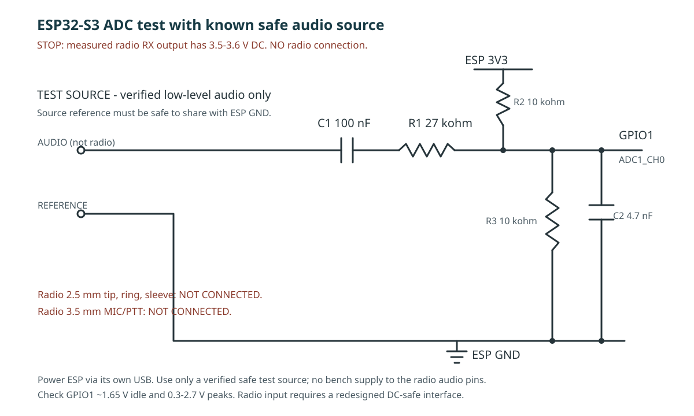

# Funkcionális hardverterv - rádióhang-felvevő

Ez a lista a [követelmények](../requirements.md) szerinti **felvétel, Wi-Fi webszerver, helyi/rádiós visszajátszás és automatizmusok** kipróbálásához szükséges hardvert gyűjti össze. Az akkumulátor, töltés, végleges ház és üzemidő most nincs méretezve. A felvétel jogi kérdése a projekt részéről tisztázott; ez a jegyzet nem vizsgálja újra. Az éterbe történő adást nem tekintjük az első próbapad részeként: a PTT és a rádió felé menő hang előbb külön, RF nélküli tesztterheléssel vizsgálandó.

## Első lépcső: ADC-próba rádió nélkül



**STOP - a rádiót ne csatlakoztasd a rajzhoz.** A 2026-10-25-én a 2.5 mm-es tip és sleeve között mért érték vétel nélkül 0 V, vétel közben **3.5-3.6 V DC**, illetve **3.4-4 V AC** a multiméter szerint; az AC-érték a hangerővel változik. Ez nem felel meg az alább eredetileg előírt, elhanyagolható differenciális DC feltételnek. A két hangérintkező közé közvetlenül tett transzformátor-primer DC-terhelést kaphat és telítésbe mehet; a rajz rádióoldali bekötése **érvénytelen**, amíg nincs újratervezve. A multiméter beszédnél nem ad megbízható csúcsfeszültséget. Most csak az ESP előfeszítő/ADC oldala építhető meg, rádió nélkül; a rádiót a saját akkujáról járasd.

Az [adott pinout-képen](2026-10-24_11h20_03.png) a csatlakozósor **GPIO1** jelű pontja ADC1_CH0; a microSD jelei **GPIO38 = CMD, GPIO39 = CLK, GPIO40 = DATA0**. Kamera nélkül a GPIO1 jó *jelölt* az első mono felvételi próbához. A kép nem bizonyítja, hogy az OV5640-es vásárolt panel minden vezetéke azonos: az „1” szitázást és az SD működését a kézben lévő panelen ellenőrizni kell. GPIO1-et választjuk, **nem** a 2.5 mm-es dugó első érintkezőjét vagy a panel soros első lábát. Az [Espressif ADC-leírása](https://docs.espressif.com/projects/esp-idf/en/stable/esp32s3/api-reference/peripherals/adc/index.html) megerősíti a GPIO1/ADC1 csatornát és a folyamatos mintavételi módot.

**A most megépíthető ESP-oldali próbához szükséges:** 2 db 10 kΩ, 1 db 27 kΩ ellenállás; 100 nF soros csatoló- és 4.7 nF szűrőkondenzátor; próbalap, multiméter és egy ismert, kis szintű, az ESP felé megfelelően illesztett próbajel-forrás. Rádióhoz való 2.5 mm-es dugó és hangfrekvenciás leválasztó transzformátor **most nem szükséges**; a mért DC mellett a korábban rajzolt primerkapcsolás nem használható. Az első fázisban **nem kell** INMP441, MAX98357A, DAC, relé/PTT, RTC vagy webszerver. Az ESP-t a saját USB-csatlakozójáról tápláld.

```text
Rádió 2.5 mm TRS: tip, sleeve és ring -> NINCS BEKÖTVE
Transzformátor primer: -> NINCS BEKÖTVE (DC-csatolás újratervezendő)

Ismert, megfelelően illesztett próbajel -> 100 nF soros kondenzátor -> 27 kΩ -> ESP GPIO1 (ADC1_CH0)
Próbajel-forrás igazolt közös referenciaja -----------------------------> ESP GND
ESP 3V3 -> 10 kΩ -> GPIO1 -> 10 kΩ -> ESP GND
GPIO1 -> 4.7 nF -> ESP GND

Panel saját microSD-foglalata: CMD=GPIO38, CLK=GPIO39, DATA0=GPIO40 (1 bites mód jelölt)
```

**A rádióoldali bemeneti fokozat újratervezése előtt** a pontos rádió-/jackváltozat és a terhelés alatti jelalak mérendő. A [telefonos kapcsolás](UV5R%20audio%20interface.md) nem hiteles készülék-pinout. Hálózati földelésű szkóp földcsipeszét ne tedd egyik ismeretlen hangérintkezőre sem; differenciális vagy leválasztott mérési módszer kell. Se tipet, se sleeve-et ne köss ESP GND-re pusztán a mért számok alapján. A korábbi telefonos **470 Ω-os** vezeték nem ADC-bemenetvédő/előfeszítő áramkör, azt ne másold át. Vételi próbafelvétel csak igazolt, DC-t kezelő új bemeneti fokozat után kezdhető.

A két 10 kΩ-os ellenállás kb. **1.65 V nyugalmi középfeszültséget** ad a GPIO1-nek. A 27 kΩ és a párhuzamosan 5 kΩ-ot jelentő előfeszítés a transzformátor szekunder jelét kb. **0.16-szorosára** csillapítja (terheléstől függő becslés). Az ADC-t a szélesebb bemeneti tartományt adó **12 dB-es csillapítással** állítsuk be. **Csak igazoltan kis jelszinttel** csatlakoztass rádiót: a bekapcsolás előtt mérj kb. 1.65 V nyugalmi feszültséget a GPIO1-en, vétel közben pedig szkóppal ellenőrizd, hogy a beszédcsúcsok kb. 0.3-2.7 V között maradnak, nem lapulnak el, és a bemenet semmiképp sem megy 0 V alá vagy 3.3 V fölé. A 4.7 nF csak egyszerű próbaszűrő, nem garantált anti-alias szűrő; a belső ADC zaját/frekvenciaátvitelét a visszahallgatott mintán kell elbírálni. Ha ez a hangút túl zajos vagy torz, akkor lépünk át dokumentált külső I2S ADC/kodek modulra; a lentebb felsorolt kodekek **nem** előfeltételei ennek az első próbának.

**Rögzítési viselkedés a hardverpróbához:** kezdetben 22 050 mintavétel/s, mono WAV; az ADC *folyamatos mintavételi* perifériáját használjuk, nem időzítetlen `analogRead()`-hívások sorát. A nyugalmi ADC-középértéket vonjuk ki, rövid (például 10-20 ms-os) blokkok hangszintjét átlagoljuk; hiszterézissel és állítható csendidővel indítsunk/zárjunk fájlt. A beszéd elejét egy 2 s-os körpuffer tartja meg (22 050 x 2 bájt x 2 s = **88 200 bájt** PCM-adat), amit a hanginduláskor a fájl elejére kell írni. A WAV 16 bites mintái **nem** jelentenek 16 bites minőséget: az ESP belső ADC-je 12 bites, a felvétel zaját külön mérni kell. Csak a kártyaírás és az ADC együttes próbaeredménye után érdemes finomítani a VAD-küszöböt és hosszabbítani az előpuffert.

## Választott kiindulópont

A már meglévő **ESP32-S3-N16R8 CAM + microSD** panel az első prototípus vezérlője, nem végleges panelválasztás. A termékoldal OV5640 kamerát ír, míg a [pinout-jegyzet](pinout.md) OV2640-hez készült; **egyetlen GPIO-kiosztás sem tekinthető még jóváhagyottnak**. A kamerát a funkciók nem igénylik. Az alaplapnak az SD-írás, a hang folyamatos feldolgozása és a Wi-Fi webkiszolgálás közbeni egyidejűséget kell bizonyítania.

| Funkció | Szükséges hardver | Állapot / nyitott pont |
| --- | --- | --- |
| Egy rádiócsatorna figyelése, hangra induló felvétel előpufferrel | Rádió fejhallgató-/hangszórókimenete, igazolt tartozékcsatlakozó, védett analóg illesztés, audio ADC/kodek, vezérlő és RAM | Rádió rendelkezésre áll; csatlakozó, jelszint, földelés és panel GPIO ellenőrizendő. Digitális INMP441 **nem** helyettesíti a rádió analóg bemenetét. |
| Dátumozott fájlok, több ezer felvétel | Meglévő microSD-foglalat, jó minőségű microSD (32 GB első teszthez), külső elemes RTC (pl. DS3231) | A kártya és az RTC tényleges meglétét ellenőrizni kell; SD-busz kiosztása ismeretlen. RTC-elemet csak a kiválasztott modul kialakításának megfelelően válasszunk. |
| Telefonos webszerver és Wi-Fi be-/kikapcsolás | ESP32-S3 beépített Wi-Fi, külön helyi nyomógomb | AP és meglévő hálózati üzemhez nem kell külön Wi-Fi modul. Külön GPIO kell a gombnak; Wi-Fi nélkül is folytatódik a felvétel. |
| Felvétel meghallgatása telefonról | Ugyanaz a Wi-Fi, webszerver, microSD | Nincs telefonos hangmodul: a böngésző a letöltött/streamelt felvételt játssza le. Egyidejű SD-olvasás és -írás próbálandó. |
| Saját hangszórós lejátszás | Kodek DAC-kimenet + hozzá illő analóg erősítő + hangszóró **vagy** igazolt külön I2S-erősítőút | A felmerült PAM8403 analóg, a meglévő MAX98357A digitális I2S-bemenetű; nem azonos módon köthetők a DAC-hoz. |
| Helyi mikrofon felvétele/élő beszéd | Második, a rádióhangtól független bemenet: kodek ADC + analóg mikrofon/előerősítő **vagy** meglévő INMP441 I2S mikrofon | Külön helyi gomb indítja; a rádió hangérzékelése ettől nem indulhat. Egyidejű bemenetek/buszok ellenőrzendők. |
| Felvétel visszajátszása a rádió felé | Hang DAC, szabályozható és csatolt mikrofonszintű illesztés a rádió bemenetéhez; alapállapotban nyitott relé + meghajtó a PTT-hez | A rádió mikrofonbemenetére **nem** hangszóró-erősítő kimenete kerül. Jack/PTT bekötés csak ellenőrzött rádióhoz; külön RF nélküli reléteszt. |
| Ütemezett/véletlenszerű lejátszás, TOT és prioritás | Ugyanaz az RTC, nem felejtő beállítástár, PTT-vezérlés, külön kézi stop lehetősége | Önálló „automatizmus-modul” nem kell. Resetkor és hiba esetén a PTT-t elengedő hardver, adásidő-korlát és leállító kezelőszerv kell. |

## Javasolt hangút az első teljes funkciópróbához

**Elsőként** keressünk dokumentált fejlesztőmodult olyan teljes duplex hangkodekkel, amelynek **két külön használható analóg ADC-csatornája és két külön vezérelhető DAC-kimenete** van. Az egyik bemenet a védetten illesztett rádióhang, a másik egy analóg helyi mikrofon/előerősítő (felmerült: MAX4466-M); az egyik kimenet mikrofonszintre illesztve a rádióhoz, a másik egy kis analóg hangszóró-erősítőhöz kerülhet. A [TLV320AIC3204](https://www.ti.com/product/TLV320AIC3204) gyárilag 2 ADC/2 DAC csatornás **IC-jelölt**, de a gyári fejlesztőkészlete drága; önmagában nem kész rádióillesztő. A [Waveshare WM8960 Audio Board](https://www.waveshare.com/wm8960-audio-board.htm) olcsóbb, [kapcsolási rajzzal dokumentált](https://www.waveshare.com/wiki/WM8960_Audio_Board) kodekmodul-jelölt, beépített mikrofonnal és hangszóró-meghajtással; az elérhető rádióhang-bemenetet és a helyi hangszórótól **független**, rádióhoz illeszthető analóg kimenetet még a konkrét panelrajzon ellenőrizni kell. Egyelőre egyik sem jóváhagyott vásárlás. Kiválasztás előtt ellenőrizni kell a modul ADC/DAC-útjait, I2S+I2C vezérlését, csatlakozóit, feszültségeit és beszerzését.

Alternatíva: analóg rádióhanghoz külön ADC/kodek, a már meglévő **INMP441** a helyi beszédhez és **MAX98357A** a helyi hangszóróhoz. Ez is megvalósítható lehet, de több külön I2S adatút, megfelelően kiosztható órajel/busz és külön rádiómikrofon-DAC kell; a három modul egymás mellé tétele önmagában **nem** alkot kétirányú hanginterfészt. A buszok és a kamerás panel szabad lábai nélkül egyiket sem rendeljük meg végleges megoldásként.

Az [ESP32-S3 két I2S vezérlőt tartalmaz](https://docs.espressif.com/projects/esp-idf/en/stable/esp32s3/api-reference/peripherals/i2s.html); egy sztereó, kétirányú kodekhez elég lehet egy RX/TX pár, ha az órajelek és a kivezetések egyeznek. Az INMP441 és MAX98357A kombinálása a maradék RX/TX csatornákon csak kompatibilis órajelek és igazolt szabad GPIO-k esetén vállalható. Ugyanazon vezérlőn a teljes duplex mód közös BCLK/WS jelet kíván; a kamerás panelen ezt külön próbával kell igazolni. A pre-rollhoz használt PSRAM nem helyettesíti az I2S DMA számára szükséges belső memóriát.

```text
rádió hangkimenet -> mért szinthez illesztés/védelem -> ADC 1 --+
                                                              |-> előpuffer -> VAD -> SD/WAV -> web/telefon
helyi mikrofon -> előerősítés / I2S -> ADC 2 vagy digitális út -+
SD/WAV -> DAC 1 -> rádió-mikrofonszintű illesztés -> rádió MIC
SD/WAV -> DAC 2 / külön I2S -> kis erősítő -> helyi hangszóró
ESP32-S3 GPIO -> alapállapotban elengedő relémeghajtó -> PTT tesztterhelés
RTC + kezelőgombok -> ESP32-S3; microSD <-> ESP32-S3; telefon <-> Wi-Fi
```

A [meglévő rádiójack-vázlat](UV5R%20audio%20interface.md) telefonos hangátalakítóhoz készült, **nem ellenőrzött készülék-pinout**. Rádióhoz csak a pontos tartozékcsatlakozó, hangkimenet AC/DC szintje, MIC-bias és földelés ellenőrzése után csatlakozzunk; ismeretlen, esetleg híd-kimenetű hangszóróágat ne kössünk közvetlenül a vezérlő földjére. Az illesztésbe szükség szerint osztó, csatolás, bemenetvédelem vagy leválasztás kerül.

## Beszerzendő / ellenőrizendő tételek

| Tétel | Első próba | Döntés előtt ellenőrizendő |
| --- | --- | --- |
| ESP32-S3 + SD-foglalat | Meglévő panel | Pontos revízió, OV5640/SD és kivezetett GPIO-k; működő SD-hozzáférés |
| MicroSD | 32 GB-os jó minőségű kártya | Írás közbeni olvasás, sok fájl, hiba utáni fájlhelyreállítás |
| Audio ADC/DAC | Két analóg be- és kimenetű kodek **dokumentált modulja** (WM8960 board csak jelölt), vagy külön ADC + DAC és I2S-útvonalak | Megvásárolható modul és konkrét kapcsolási rajz; valódi párhuzamos bemenetek/kimenetek |
| Rádió-hangillesztő | Tartozék-csatlakozó/breakout, csatolás, védelem, szükség esetén izoláció | Pontos rádió és csatlakozó; szintek/tesztelhető dokumentáció |
| Helyi mikrofon | Analóg mikrofon + előerősítő a kodekhez, vagy meglévő INMP441 | A második bemenet és a busz útvonala |
| Saját hangszóró | Kodek analóg kimenetéhez illő kis erősítő + hangszóró, vagy meglévő MAX98357A + hangszóró | A kiválasztott kimenet analóg vagy I2S, terhelhetőség, busz és szabad GPIO |
| RTC | DS3231 modul + megfelelő tartalékelem | I2C-busz, elem/elemtöltő áramkör, óraátállítás szoftveres kezelése |
| Kezelés, PTT | Külön Wi-Fi-, helyi beszéd- és kézi stop gomb, NO relé és meghajtó | Resetkori elengedés, független adásidő-korlát, pontos rádiókapcsolat |
| Beállítások | Meglévő ESP32 nem felejtő tára vagy a DS3231+AT24C32 modul EEPROM-ja | Melyik tároló megbízható és elérhető; külön EEPROM csak ha kell |

Opcionális: a felmerült OLED + forgó enkóder. A web és az automatikus rögzítés működéséhez nem kellenek; a pontos panel-GPIO-k után dönthetők el. A fejlesztéshez használjunk szabályozott gyári USB-tápot a panelhez, a rádiónál saját gyári tápot; ez **nem** a végső akkumulátoros architektúra.

## Legolcsóbb tisztázó próbák sorrendben

1. Azonosítani a panel fizikai revízióját, a tényleges SD-kötést és a hozzáférhető GPIO-kat; egy egyszerű SD-írással ellenőrizni, hogy a meglévő panel alkalmas-e.
2. Először az előfeszített belső ADC-n ismert, kis szintű próbajelet rögzíteni 22 050 Hz/16 bit mono WAV-ba 2 s előpufferrel; a rádiót nem csatlakoztatni. Ha a belső ADC hangminősége kevés, ellenőrzött külső audio modullal megismételni a próbát. Később 5/10 s előpufferrel is tesztelni; a 10 s mono PCM puffer kb. 441 kB, a DMA és az egyéb feladatok memóriáját ezen felül kell biztosítani.
3. Legalább 900 fájlos napterhelés mellett rögzítés közben bekapcsolni a webet, telefonról keresni, meghallgatni és letölteni; a felvétel eleje, a WAV-fejléc és a fájlrendszer maradjon ép.
4. Saját hangszórós lejátszás, kézi/ütemezett/véletlen fájlválasztás, ütközéskezelés, Wi-Fi-gomb és RTC átállásának próbája. A relé csak **szimulált PTT terhelést** kapcsoljon; resetre vagy hibára engedjen el, legyen kézi stop.
5. A rádió tip-sleeve kimenetén vétel alatt mért 3.5-3.6 V DC miatt a korábbi transzformátoros primer-bekötés nem alkalmazható. A rádió pontos csatlakozójának és terhelés alatti jelalakjának igazolása után külön, DC-t kezelő bemeneti fokozatot kell tervezni és csak utána készülhet rádiófelvétel. A rádióba visszajátszás fizikai/jelszintű próbája további külön lépés. Ha a kamerás panel GPIO-ja vagy a hangút nem igazolható, dokumentált, kamera nélküli S3 + SD fejlesztőpanelre váltás lehet a kisebb kockázat.